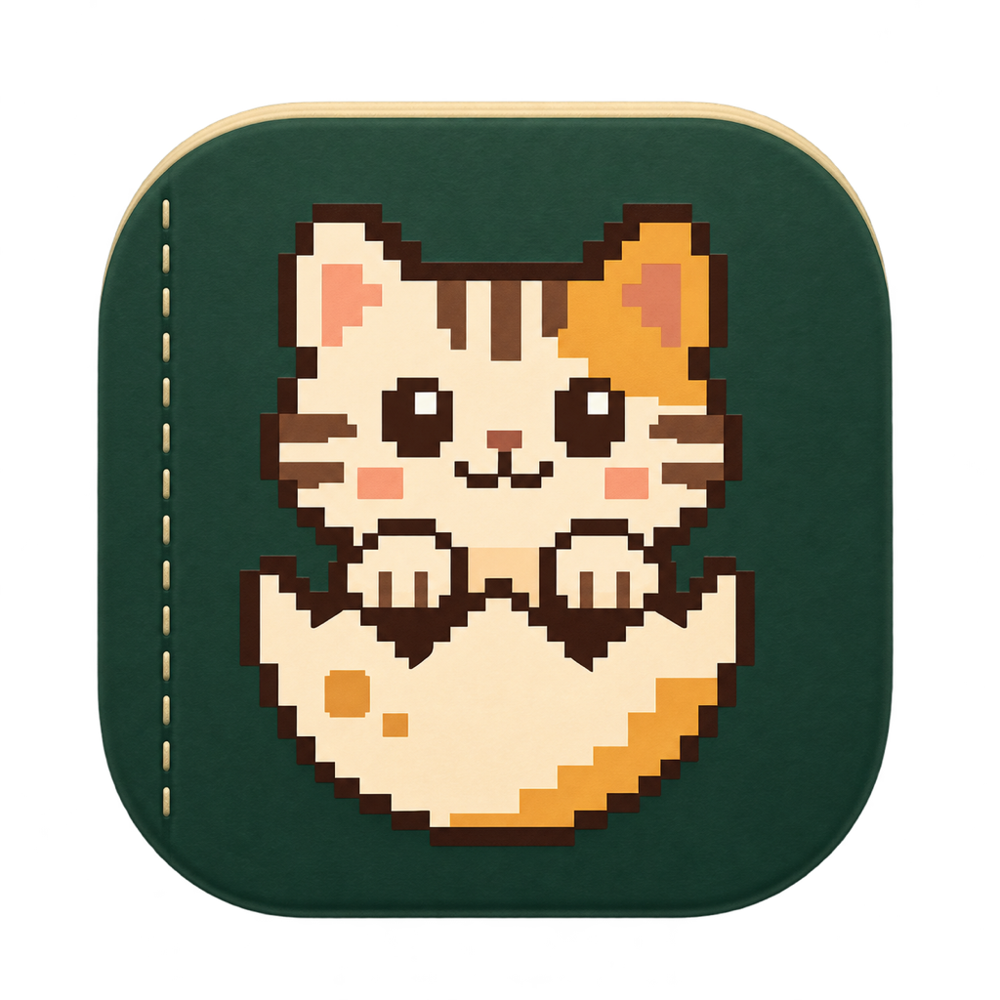
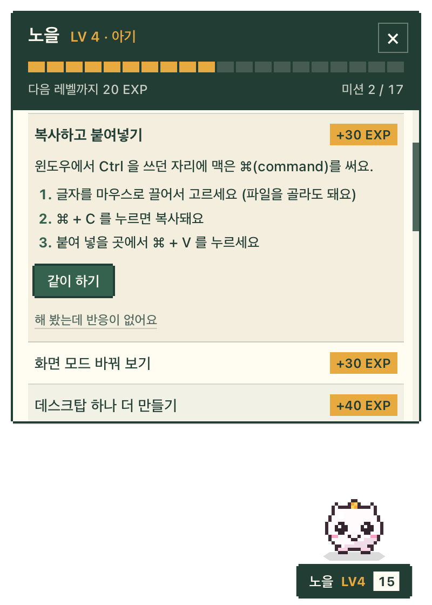
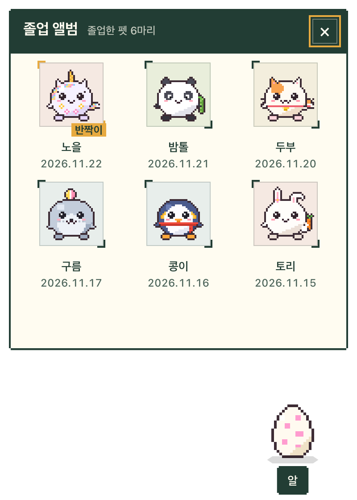

# MacPet



맥을 처음 쓰는 사람 옆에서 macOS 기능을 하나씩 알려 주는 도트 펫입니다.
펫이 권하는 미션(예: 스크린샷 찍기)을 같이 해 보겠다고 고른 뒤 실제로 해 보면 경험치를 줍니다. 경험치가 쌓이면 펫이 자랍니다.

## 설치

MacPet은 macOS 14 이상의 Apple Silicon Mac과 Intel Mac에서 동작합니다. 첫 공개 안정 버전은 **0.2.2**입니다. 첫 공개에는 소스 ZIP과 체크섬 두 파일을 올리므로, 받아서 내 Mac에서 빌드합니다. Apple 개발자 계정 등록 없이 무료로 할 수 있고, 터미널에 아래 명령을 차례로 붙여 넣으면 됩니다. 다른 사람에게 권할 때도 [릴리스 페이지](https://github.com/sjk0503/MacPet/releases) 링크를 공유하면 같은 순서로 빌드할 수 있습니다.

1. [릴리스 페이지](https://github.com/sjk0503/MacPet/releases)에서 **v0.2.2**의 **Assets**를 펼쳐 아래 두 파일을 눌러 받습니다.
   - `MacPet-0.2.2-source.zip`
   - `MacPet-0.2.2-source.zip.sha256`

   GitHub가 자동으로 붙이는 “Source code (zip)”, “Source code (tar.gz)”는 체크섬 대상이 아니므로 받지 않습니다. Safari가 ZIP을 자동으로 풀어 `MacPet-0.2.2-source` 폴더만 남았다면, Safari 설정 > 일반에서 “다운로드 후 ‘안전한’ 파일 열기”를 끄고 ZIP을 다시 받으세요. 확인에는 ZIP 원본이 필요합니다.

2. 터미널(응용 프로그램 > 유틸리티)을 열고 받은 파일이 맞는지 확인합니다. 파일을 다른 폴더에 받았다면 `~/Downloads` 대신 그 폴더를 쓰세요(`cd ` 뒤에 Finder의 폴더를 끌어다 놓으면 경로가 입력됩니다).

   ```bash
   cd ~/Downloads
   shasum -a 256 -c MacPet-0.2.2-source.zip.sha256
   ```

   `MacPet-0.2.2-source.zip: OK`가 나오면 다음으로 넘어갑니다. 다른 결과가 나오면 두 파일을 다시 받으세요.

3. Swift 5.9 이상이 있는지 확인합니다.

   ```bash
   swift --version
   ```

   버전이 나오지 않으면 아래 명령으로 Apple의 명령어 라인 도구를 설치합니다. 설치 창이 끝났다고 알려 줄 때까지 기다린 뒤 `swift --version`을 다시 실행하세요.

   ```bash
   xcode-select --install
   ```

   5.9보다 낮게 나오면 시스템 설정 > 일반 > 소프트웨어 업데이트에서 Command Line Tools를(Xcode를 쓴다면 Xcode를) 업데이트한 뒤 다시 확인합니다.

4. macOS에 들어 있는 `ditto`로 `~/MacPet` 폴더에 압축을 풀고, 빌드해서 엽니다.

   ```bash
   mkdir -p ~/MacPet
   ditto -x -k MacPet-0.2.2-source.zip ~/MacPet
   cd ~/MacPet/MacPet-0.2.2-source
   bash scripts/build-app.sh
   open build/MacPet.app
   ```

   첫 빌드는 몇 분 걸릴 수 있습니다. 저장소를 체크아웃한 경우에도 `Package.swift`가 있는 폴더에서 마지막 두 명령을 실행하면 됩니다.

공증을 마친 뒤에는 같은 v0.2.2 릴리스의 Assets에 Universal 앱 `MacPet-0.2.2-macos-universal.zip`과 `MacPet-0.2.2-macos-universal.zip.sha256`을 추가합니다. Assets에 이 두 파일이 보이면 빌드 없이 받아 2단계처럼 체크섬을 확인하고, ZIP을 풀어 `MacPet.app`을 응용 프로그램 폴더로 옮겨 엽니다. 배포자용 서명·공증 절차는 [릴리스 안내](docs/RELEASING.md)에 있습니다.

## 첫 실행과 펫 키우기

앱을 열면 화면 오른쪽 아래에 알이, 메뉴 막대에 발바닥이 나타납니다. 알을 세 번 두드리면 부화하고, 펫이 미션을 하나씩 권합니다. 부화와 진화 장면에서도 창은 투명해서 뒤의 데스크탑이 그대로 보입니다.

권유에 붙은 `+EXP`는 그 미션을 마쳤을 때 받을 수 있는 경험치입니다. 말풍선의 "알려 줘"나 미션 카드의 "같이 하기"를 눌러야 미션이 시작되고, 펫이 자동으로 지켜보는 것은 그렇게 고른 미션 하나뿐입니다. 권유를 보기만 하거나, 앱을 켜 두거나, 다른 미션에 해당하는 동작을 한 것으로는 미션 경험치가 오르지 않습니다.

- **단축키 미션**은 시작한 뒤 그 미션의 단축키 조합을 정확히 누르면 한 번 완료됩니다.
- **앱 열기, 복사, 라이트/다크 전환, 스크린샷, 데스크탑 전환, 설정 변경 미션**은 평소에도 일어나는 변화라서, 펫이 알아챈 뒤 "내가 했어요"를 눌러야 경험치를 받습니다.
- **권한 미션**은 macOS에서 손쉬운 사용 권한이 실제로 허용되어야 완료됩니다. 조건은 [손쉬운 사용 권한](#손쉬운-사용-권한)에 있습니다.
- 해 봤는데도 펫이 알아채지 못하면, 직접 확인을 받는 일반 미션은 그 미션의 카드를 골라 "해 봤는데 반응이 없어요"를 누른 뒤 "정말 해 봤어요"로 확인해 완료할 수 있습니다. 펫이 지켜보고 있지 않은 미션이어도 됩니다. 권한 미션에는 이 방법이 없습니다.
- 펫을 숨기거나 앱을 다시 열면 지켜보던 미션은 멈춥니다. "안내 계속하기"를 누르거나 미션을 다시 시작하면 이어지고, 그 전에 있었던 변화는 세지 않습니다.

펫을 직접 쓰다듬으면 미션과 별개로 +2 EXP를 받습니다. 하루 다섯 번까지입니다.

이름표를 누르면 전체 미션 카드가 열립니다.
끄기·숨기기·처음부터 다시는 메뉴 막대의 발바닥 아이콘에 있습니다.

펫이 **Lv.10**에 도달하면 졸업해 도감에 남고 새 알이 옵니다. 새 알도 세 번 두드려 이름을 지어 주세요. 다음 펫은 Lv.1에서 시작하고, 앞선 펫들이 해 보지 않은 미션을 먼저 권합니다. 메뉴 막대의 **펫 도감**을 열면 졸업한 펫의 모습과 이름, 졸업 날짜를 볼 수 있습니다.

 

펫을 누른 채 끌면 자리를 옮길 수 있고, 옮긴 자리는 기억됩니다.

대부분의 미션은 권한 없이 동작합니다. 단축키 미션과 "눌러야 할 곳 표시"만 손쉬운 사용 권한이 필요하고, 그 권한을 주는 것도 미션으로 안내합니다.

화면을 수정하는 기여자는 [디자인 기준과 Impeccable 사용법](DESIGN.md)을 참고하세요.

## 앱 업데이트와 저장

업데이트는 자동으로 받거나 설치하지 않습니다. 메뉴 막대의 **새 버전 보기…**는 릴리스 페이지를 열기만 하고, 다운로드와 설치는 직접 합니다.

1. 새 버전의 소스를 [설치](#설치)와 같은 순서로 받아 빌드합니다.
2. 메뉴 막대의 발바닥에서 쓰던 MacPet을 먼저 종료합니다.
3. 쓰던 위치의 `MacPet.app`을 새 앱으로 교체하거나, 새 소스 폴더의 `build/MacPet.app`을 그대로 엽니다. 어느 쪽이든 같은 저장을 읽습니다.

공증된 앱 ZIP을 받았다면 종료 후 응용 프로그램 폴더의 앱을 새 앱으로 교체합니다. 교체한 뒤 단축키 미션이 반응하지 않으면 손쉬운 사용 권한을 다시 허용해 주세요([손쉬운 사용 권한](#손쉬운-사용-권한) 참고).

키우던 펫은 그대로 이어집니다. 진행도는 `~/Library/Application Support/MacPetGuide/save.json`에 보관합니다. 0.2.x에서도 기존 번들 ID와 저장 형식 `v:1`을 사용하므로 0.1.0에서 키우던 펫을 그대로 이어갈 수 있습니다. 읽을 수 없는 파일이나 더 새로운 형식을 만나면 원본을 보존하고 화면에 상태를 알려 줍니다.

**새 버전 보기…**가 여는 주소는 빌드할 때 정해집니다. git 정보가 없는 소스 ZIP으로 빌드하면 [공식 릴리스 페이지](https://github.com/sjk0503/MacPet/releases), origin이 GitHub인 포크 체크아웃에서 빌드하면 그 포크의 릴리스 페이지입니다. 그 밖의 경우와 주소를 직접 지정하는 방법, Universal ZIP 만들기, SHA-256 확인, Developer ID 서명과 공증 절차는 [릴리스 안내](docs/RELEASING.md)에 있습니다.

## 미션과 감지 방식

미션은 [web/missions.json](web/missions.json) 에 데이터로 적습니다. `trigger.type` 이 아래 중 하나면 코드 수정 없이 미션을 추가할 수 있습니다.

표의 "무엇을 관찰하나"는 감지기가 알아채는 변화이고, 그 자체로 완료는 아닙니다. 자동 관찰은 사용자가 고른 미션 하나에만 쓰이며, 완료 조건은 표 아래에 있습니다.

| type | 무엇을 관찰하나 | 쓰는 것 |
|---|---|---|
| `appOpen` | `bundleId` 의 앱이 앞으로 나옴 | `NSWorkspace` 앱 활성화 알림 |
| `screenshot` | 스크린샷 폴더(설정된 위치와 데스크탑)에 새 그림 파일이 생김 | 폴더 변경 알림(FSEvents) + Spotlight |
| `clipboardChange` | 무언가 복사됨 (내용은 읽지 않음) | 0.7초마다 클립보드 변경 횟수 읽기 |
| `appearanceChange` | 라이트/다크가 바뀜 | 시스템 알림 `AppleInterfaceThemeChangedNotification` |
| `spaceChange` | 다른 데스크탑(또는 전체 화면)으로 옮겨 감 | `NSWorkspace` 데스크탑 전환 알림 |
| `defaultsChange` | `domain` 의 `keys` 중 하나가 바뀜. `to` 가 있으면 그 값이 될 때만, `ignoreValues` 는 제외 | 1.5초마다 설정값 읽기 |
| `accessibility` | 손쉬운 사용 표시 옵션(`flag`)이 `to` 값으로 바뀜 | `NSWorkspace` 공개 API |
| `accessibilityPermission` | 손쉬운 사용 권한이 실제로 허용되어 있는지 | 권한 변경 알림과 `AXIsProcessTrusted` 재확인 |
| `shortcut` | `keys`(예: `cmd+tab`)를 누름. 손쉬운 사용 권한 필요 | 듣기 전용 키 이벤트 탭, 사용할 수 없으면 AppKit 전역 이벤트 감시 |
| `manual` | 감지하지 않음. 사용자가 직접 확인 | 없음 |

완료되는 조건은 종류에 따라 다릅니다.

- `shortcut`: 지켜보는 미션의 `keys` 와 정확히 일치하는 입력이 들어오면 한 번 완료됩니다.
- `appOpen`, `screenshot`, `clipboardChange`, `appearanceChange`, `spaceChange`, `defaultsChange`, `accessibility`: 지켜보는 미션에서 관찰된 뒤 사용자가 "내가 했어요"를 눌러야 완료됩니다.
- `accessibilityPermission`: 실제 허용 상태로만 한 번 완료됩니다. 꺼져 있다가 미션 중에 새로 허용되면 그 변화로, 시작 전부터 허용되어 있었으면 "허용 상태 확인"을 눌렀을 때 완료됩니다([손쉬운 사용 권한](#손쉬운-사용-권한)).
- `manual`: 사용자가 "정말 해 봤어요"로 확인하면 완료됩니다.

직접 확인을 받는 일반 미션은 자동 관찰과 별개로, 카드에서 "해 봤는데 반응이 없어요" → "정말 해 봤어요"로도 완료됩니다.

- `flag` 로 쓸 수 있는 값: `reduceMotion`, `increaseContrast`, `reduceTransparency`, `invertColors`, `differentiateWithoutColor`.
- `defaultsChange` 의 `to` 와 `ignoreValues` 에는 숫자·불리언·문자열을 쓸 수 있습니다(`true` 는 `1` 과 같게 봅니다).
- `shortcut` 의 `keys` 는 `cmd`/`shift`/`option`/`ctrl` 과 키 이름을 `+` 로 잇습니다. `cmd`·`ctrl`·`option` 중 하나는 꼭 있어야 합니다(일반 타이핑과 겹치지 않게).
- 그 밖의 필드: `group`(카드에서 묶는 이름), `why`, `steps`(펫이 한 단계씩 안내), `settingsURL`("설정 열기" 버튼), `after`(성공 뒤 한 줄 팁), `xp`, `needs: "accessibility"`(권한이 있어야 감지되는 미션), `permission: "accessibility"`(권한을 주는 미션).

### macOS 업데이트로 미션이 달라질 때

새 버전에서 안내 문구나 감지 방식이 바뀌면 해당 미션에 `osOverrides`를 추가합니다. 예를 들어 아래 항목은 해당 범위에서만 기본 `steps`를 교체합니다. 미션 ID와 경험치를 유지하므로 기존 완료 기록이 이어집니다.

```json
"osOverrides": [
  {
    "minOS": "27.2",
    "maxOS": "27.2",
    "steps": ["이 버전에서 확인한 메뉴 이름과 조작 순서를 적으세요."]
  }
]
```

앱은 실행 중인 macOS에 맞는 정의를 화면과 감지기에 함께 전달합니다. 범위가 겹치거나 카탈로그에 잘못된 값이 있으면 `swift test`에서 진단을 확인할 수 있습니다. Apple 새 빌드 감지와 버전별 점검 항목은 [macOS 호환성 안내](docs/COMPATIBILITY.md)에 있습니다.

### 눌러야 할 곳 표시

`steps` 의 항목을 문자열 대신 객체로 쓰면, 그 단계에서 다른 앱의 버튼 자리에 화살표를 띄웁니다.

```json
{ "text": "‘투명도 줄이기’를 켜 보세요",
  "point": { "app": "com.apple.systempreferences", "label": "투명도 줄이기" } }
```

| 필드 | 뜻 |
|---|---|
| `app` | 대상 앱의 번들 ID |
| `label` | 요소의 이름. 제목·설명·값 중 하나와 같아야 함 |
| `role` | 있으면 그 역할만 (예: `AXButton`, `AXMenuBarItem`) |
| `in` | `window`(기본), `menubar`, `dock` |
| `window` | 있으면 앞 창의 제목이 이것일 때만 |

- 창과 메뉴의 대상은 그 앱이 앞에 나와 있을 때만 표시합니다. 스크롤해야 나오는 요소와 숨겨진 Dock의 아이콘은 화면에 보일 때부터 가리킵니다.
- 이름으로 찾기 때문에 `label` 은 macOS 표시 언어(지금은 한국어)와 버전에 맞아야 합니다.

## 손쉬운 사용 권한

- **쓰는 곳:** 미션에 적힌 단축키를 눌렀는지 확인하는 것과, 다른 앱 화면에서 버튼의 이름·역할·위치를 읽는 것 두 가지입니다. 아무것도 대신 누르지 않습니다.
- **키 입력:** 미션 단축키와 일치하는지만 비교하고, 일치하지 않는 입력은 그 자리에서 버립니다. 키 코드나 글자를 저장하거나 로그로 남기지 않습니다([ShortcutWatcher.swift](Sources/MacPet/ShortcutWatcher.swift)).
- **빌드할 때마다 권한이 풀리는 문제:** 기본 서명(ad-hoc)은 빌드마다 서명이 달라져서 권한을 다시 줘야 합니다. 코드 서명 인증서로 서명하면 권한이 유지됩니다. 인증서의 이름이나 SHA-1 해시를 프로젝트 폴더의 `.signing-id` 파일에 한 줄로 적어 두면 빌드 스크립트가 매번 그 인증서로 서명합니다(이 파일은 저장소에 올라가지 않습니다). 한 번만 지정하려면 환경변수를 씁니다.

```bash
security find-identity -v -p codesigning
```

```bash
MACPET_SIGN_ID="인증서 이름 또는 해시" bash scripts/build-app.sh
```

권한 미션은 macOS에서 실제로 허용된 것이 확인되어야 완료됩니다.

- **권한이 꺼져 있을 때:** 권한 미션을 시작하거나 "권한 요청하기"를 누른 뒤 시스템 설정에서 MacPet을 켜면, 그 변화가 전해지는 대로 완료됩니다. "허용 상태 확인"은 누르지 않아도 됩니다.
- **시작하기 전부터 켜져 있을 때:** 권한 미션을 고르고 "허용 상태 확인"을 누르면 완료됩니다. 누르기 전에는 권한이 켜져 있다는 사실만으로 경험치가 붙지 않습니다.

권한을 껐다가 다시 켜려면 잠긴 단축키 카드에서 "권한 미션 보기"를 누르세요. 이것은 권한 복구이지 새 미션이 아니어서, 다시 허용해도 경험치는 한 번만 지급됩니다.

손쉬운 사용 목록에서 MacPet이 켜져 있는데 앱을 다시 열어도 로그에 `[access] accessibility trusted: false`가 나오면, 목록에서 MacPet 항목을 선택해 ‘−’로 제거하세요. ‘+’로 현재 빌드한 `build/MacPet.app`을 다시 추가하고 켜면 앱이 권한을 다시 확인합니다. 로그의 `[access] accessibility trusted: true`로 확인할 수 있습니다.

## 알려진 한계

- 스크린샷은 파일을 열어 보지 않고 관찰합니다. 그래서 스크린샷 폴더로 그림 파일을 옮기거나 이름을 바꿔도 스크린샷을 찍은 것으로 알아챕니다. 클립보드로만 복사하는 스크린샷은 알아채지 못합니다.
- 복사, 데스크탑 전환, 앱 열기는 안내를 따르지 않고 평소처럼 그 동작을 해도 알아챕니다. 이렇게 잘못 알아채더라도 시작한 미션에만 반영되고, "내가 했어요"를 누르기 전에는 경험치가 붙지 않습니다.
- 알 상태이거나 미션을 시작하기 전에 한 동작은 기록하지 않습니다. 미션을 시작한 뒤 다시 해 보세요.

## 구조

```
Sources/MacPetCore/   미션 모델과 판정 로직 (순수 함수, 테스트 대상)
Sources/MacPet/       투명 창, 웹뷰 연결, 미션 감지, 권한, 단축키, 눌러야 할 곳 표시, 저장, 메뉴 막대
web/engine.js         도트 그리기 엔진
web/app.js            펫 화면과 육성 규칙
web/generations.js    펫 졸업과 세대별 기록
web/collection.js     졸업 앨범 화면
web/missions.json     미션 정의
scripts/build-app.sh  build/MacPet.app 만들기
```

네이티브와 웹 화면은 메시지로만 주고받습니다.

- 웹 → 네이티브: `ready`, `save`, `hitRects`(눌릴 수 있는 영역), `{type:"watchMission", id, attempt}`(지금 지켜볼 미션 시도), `openSettings`, `requestPermission`, `point`(가리킬 대상), `dragStart`, `log`
- 네이티브 → 웹: `{type:"mission", id, attempt}`, `{type:"command", name}`, `{type:"permission", name, granted}`, `{type:"visibility", visible}`

창은 평소에 클릭을 뒤 창으로 통과시키고, 마우스가 `hitRects` 안에 있을 때만 클릭을 받습니다.

사용자가 미션을 시작하면 웹 화면이 `{type:"watchMission", id, attempt}`를 보내고, 네이티브는 그 시도 하나만 지켜봅니다. `{type:"watchMission", id:null}`은 지켜보기를 취소합니다. 네이티브는 관찰한 것을 `{type:"mission", id, attempt}`로 알립니다. `attempt`는 값의 뜻을 해석하지 않고 같은지만 비교하며, 지금 시도와 맞지 않는 지난 시도의 이벤트는 버립니다.

알 상태이거나 시작한 미션이 없을 때는 경험치로 이어지는 미션 이벤트가 없습니다. 메뉴에서 펫을 숨기면 화면 갱신과 안내 화살표, 지켜보던 미션을 함께 쉽니다. 다시 보이게 한 뒤 사용자가 "안내 계속하기"를 눌러야 이어지고, 숨겨 둔 동안의 변화는 버립니다.

## 점검

미션 판정, 펫 졸업, Apple 릴리스 감지 테스트를 실행합니다.

```bash
swift test
node --test Tests/Web/*.test.js
python3 -I scripts/tests/test_check_apple_releases.py
```

실제 앱 창에서 부화와 이름 짓기, 미션 안내, 권한 복구, 창 숨기기, 이전 저장 복원, 졸업 후 다음 알 키우기를 점검합니다.

```bash
bash scripts/qa.sh
```

- `qa/*.json` 의 시나리오를 차례로 실행하고 `PASS`/`FAIL` 을 냅니다. 단계 종류는 [QARunner.swift](Sources/MacPet/QARunner.swift) 맨 위에 적혀 있습니다.
- 클릭과 키 입력을 펫 창으로 직접 보내므로 실제 마우스·키보드는 움직이지 않습니다. 누를 요소가 다른 요소에 가려졌거나 클릭을 받는 영역 밖이면 실패로 잡습니다.
- 임시 저장을 쓰고 실제 미션 감지는 꺼 두므로, 쓰던 펫의 저장과 점검 결과가 서로 영향을 주지 않습니다.
- 실제 커서가 있어야 하는 것(끌어 옮기기, 빈 곳 클릭이 뒤 창으로 통과되는지)은 이 점검으로 확인할 수 없습니다.

2026-11-23에 macOS 27.2.1에서 실제 마우스로 펫을 옮긴 뒤 재실행해 자리가 복원되는 것을 확인했습니다. 투명 영역 뒤의 버튼도 클릭을 받았습니다. 같은 Mac에서 설정 열기, 단축키 4종(⌘Tab, ⌘W, ⌘Q, ⌥⌘Esc) 감지, ‘투명도 줄이기’ 항목의 안내 화살표를 확인했습니다.

## 점검용 옵션

실행 파일(`build/MacPet.app/Contents/MacOS/MacPet`)에 붙여 씁니다.

| 옵션 | 하는 일 |
|---|---|
| `--save-path <파일>` | 진행 상태는 지정한 파일에, 창 위치는 그 옆의 `<파일>.panelOrigin`에 저장합니다. 같은 경로로 다시 실행하면 둘 다 복원됩니다. |
| `--simulate <미션 id>` | 시작 1초 뒤 그 미션의 시험 이벤트를 보냄. 사용자가 시작해 지켜보는 중인 시도와 맞을 때만 반영되고, "내가 했어요"가 필요한 미션은 그 확인까지 해야 완료됨 |
| `--command <이름>` | 시작 1초 뒤 명령을 보냄 (`showCollection`, `showMissions`, `toggleMissions`, `reset`, `devCompleteNext`). `devCompleteNext`는 `--debug`나 임시 저장을 쓰는 `--qa` 실행에서만 동작 |
| `--self-tap <횟수>` | 펫을 그 횟수만큼 누름 (실제 마우스는 움직이지 않음) |
| `--point <JSON>` | 시작 1초 뒤 그 대상을 가리킴 (위의 `point` 객체와 같은 모양) |
| `--qa <JSON 파일>` | 점검 시나리오를 실행하고 종료 (실제 감지는 끔) |
| `--regular` | Dock 에 보이는 일반 앱으로 띄움 (자동 조작 도구가 앱을 찾을 수 있게) |
| `--snapshot <png>` | 화면을 그림으로 저장하고 종료 (`--snapshot-delay <초>`) |
| `--debug` | 웹 인스펙터 허용, 파일 변경 알림과 설정 열기 결과(`[settings]`), 화살표 표시 상태(`[point]`) 기록 |

## 라이선스

MacPet은 MIT 라이선스로 공개합니다. 전문은 [LICENSE](LICENSE)에 있습니다.
